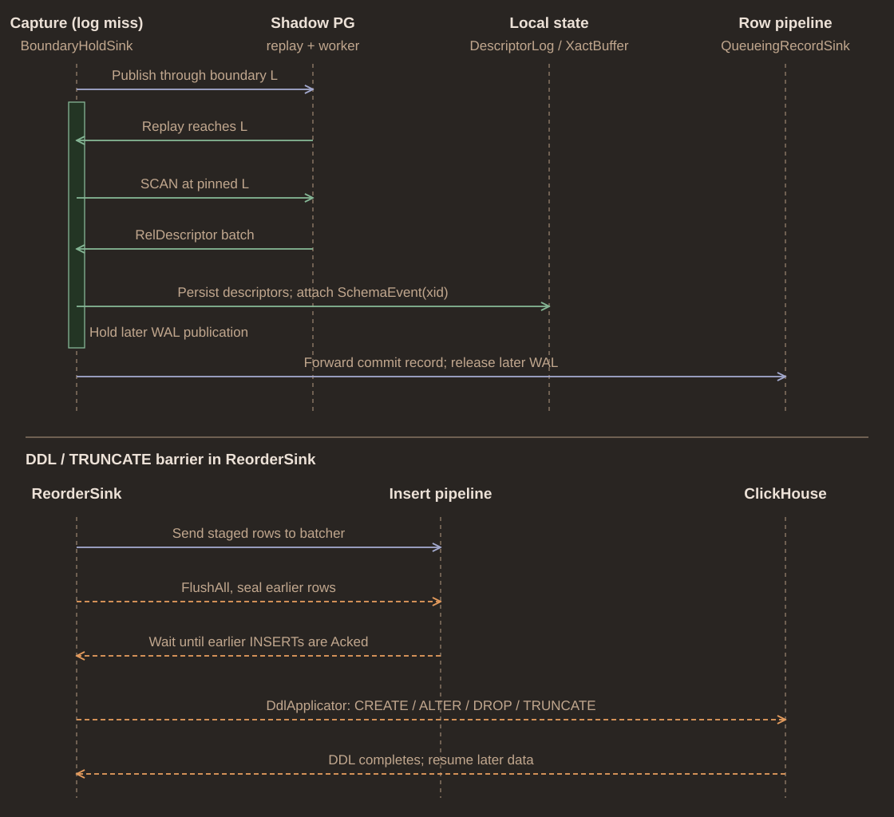

# Catalog history and schema changes

Shadow PostgreSQL supplies catalog state. Durable descriptor history supplies
which state belongs to each physical WAL record. Keeping both avoids decoding
an old tuple with a newer layout simply because replay advanced

## Capture boundaries

Catalog writes identify transactions that may change descriptors. Capture holds
successor WAL while shadow reaches a selected boundary, reads affected catalog
state, and publishes coverage before dependent row work proceeds

At a command boundary, capture reads the transaction's uncommitted catalog
for the tables named in WAL. Schema changes and table cache flushes can
also refresh names for tables already read in that transaction. Record
missed reads by table and WAL position. Abort discards provisional reads
and misses.

At commit, build each surviving table's descriptor history in WAL order.
For a gap between known descriptors on the same file, check whether the
next descriptor can read rows written under the previous one. Buffered
rows for surviving table files use their own WAL positions to look up
descriptors in the durable log, including on restart. Decoding stops if a
row falls in an unsafe range or has no descriptor at its position.

Relation identity includes tablespace, database, and filenode. Relation OID ties
successive physical generations together. Neither a name nor a filenode alone
is sufficient across renames and rewrites

## Source history and destination policy

Schema events compare full source descriptors from durable history. Destination
mapping is a separate policy: it can intentionally omit or rename columns
Comparing source only with destination columns would confuse deliberate
exclusion with a newly added source column

Destination DDL is ordered with row work. Barriers prevent rows from crossing
an incompatible schema change or destructive operation. This ordering does not
make every PostgreSQL transition supported, see
[schema-change behavior](../docs/schema-changes.md)

## Implementation

Start in [capture](../src/source/catalog_capture.rs),
[descriptor log](../src/catalog/desc_log.rs),
[pending history](../src/catalog/pending.rs),
[history builder](../src/catalog/timeline.rs), and
[reorder barriers](../src/emit/pipeline/reorder.rs)
Remaining [capture gaps](../plans/catalog.md) and
[schema transitions](../plans/schema.md) stay in plans
