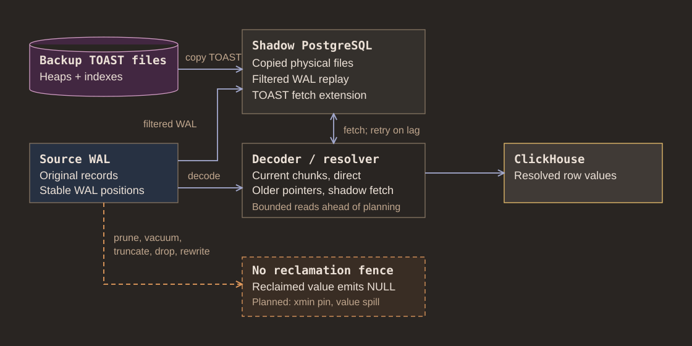

# Shadow TOAST storage

Shadow value mode keeps PostgreSQL TOAST heaps and indexes in shadow instead of
mirroring chunks into ClickHouse. Chunks from same transaction still resolve
from decoded WAL without a shadow lookup

## Bootstrap and replay

Bootstrap copies selected TOAST files into shadow data directory. Shadow then
replays filtered backup WAL through backup boundary, adding concurrent writes
and repairing copied pages through normal PostgreSQL recovery

walshadow keeps original WAL for decoding and sends retained physical records
to shadow. Existing TOAST relations are seeded explicitly. After bootstrap, a
relation begins shadow routing only when its file creation record proves shadow
has physical base file; later records for that relation follow same route. This
also retains ordinary relations created after bootstrap

Adding a relation later requires shadow to already hold its TOAST heap.
Relations created after bootstrap qualify through their file creation records.
Older relations must be included in bootstrap, since a running standby cannot
be seeded later. Admission rejects relations with missing TOAST heaps, whether
added by opt-in or config. Re-bootstrap with relation included, or use
ClickHouse mirror mode

## Reads and retention

Resolver asks extension to read chunks with referring record's position as
minimum replay bound. Extension refuses reads ahead of replay; resolver then
waits and retries. Rust side decompresses value and checks raw size. Shadow is
read-only from resolver perspective; decoded chunk writes never go back into
PostgreSQL

Bounded speculative reads fetch and decompress values ahead of commit planning.
Planning consumes matching results or resolves values normally. Schema barriers
invalidate speculative reads, and planning a commit that births chunks drops
reads of those IDs reserved before that commit. Prescan skips only values born
in referring transaction, whose chunks resolve from its own WAL. These reads do
not prevent shadow reclamation

Reads select database-specific bridge using referring row’s database OID.
Batched bootstrap lookups include database OID in value keys, so identical
TOAST relation and value IDs across databases stay separate

PostgreSQL can remove TOAST chunks before walshadow reads them for ClickHouse.
If chunks are gone or belong to a replacement value, walshadow reports the
value as superseded and writes NULL or the column default. To spot a reused
value ID, compare the newest chunk's `xmin` with the highest transaction ID
assigned when the row's WAL record was written. A newer chunk belongs to a
replacement. If some chunks are missing and the rest are older, PostgreSQL
removed part of the original value.

See how walshadow could save values before shadow removes them in the
[safe reclamation plan](../plans/shadow_toast.md)

## Source horizon pin

With `[toast] source_horizon_pin`, walshadow uses hot standby feedback to tell
source PostgreSQL which deleted row versions to keep. This keeps pruning and
vacuum from removing TOAST chunks walshadow may still need. Shadow only removes
chunks when it replays WAL from source.

The resolved floor is the WAL position walshadow can safely restart from. It
stays at or before the first record of any open transaction. Walshadow picks
the latest transaction ID sample taken at or before that position. Any
transaction that marks chunks as deleted at or after the sample's WAL
position has an ID at least as high as the sample, so PostgreSQL keeps those
chunks.

PostgreSQL logs the oldest running transaction ID (`oldestRunningXid`) about
every 15 seconds while busy. On a primary, walshadow also uses a separate SQL
connection to read a snapshot's `xmin`, then `pg_current_wal_insert_lsn()`,
once a second. A transaction writing at or after that WAL position was running
when PostgreSQL took the snapshot or started later. Walshadow orders samples
by WAL position because the SQL connection can sample WAL ahead of the stream.
A new source connection may follow another timeline, so walshadow drops
samples ahead of the WAL it has consumed. It warns once when sampling fails
and falls back to `oldestRunningXid` until sampling recovers.

Walshadow sends feedback only when the `xmin` changes, apart from standby
status, because PostgreSQL keeps the last value it received.

PostgreSQL checks the transaction ID's epoch in feedback to reject IDs from
outside the recent past. Walshadow uses the source's next full transaction ID
to work out the epoch for each 32-bit ID from WAL. With a physical replication
slot, PostgreSQL keeps the slot's `xmin` when walshadow disconnects and can
only advance or clear it.

Walshadow saves the `xmin` for the resolved floor in the resume manifest. At
startup it uses the slot's `xmin` if it has one, and warns when that is ahead
of the saved `xmin`. Otherwise it uses the saved `xmin` or the source's oldest
running transaction ID, whichever is older, and never goes below the oldest
`datfrozenxid`. Without a slot, nothing holds `xmin` while walshadow is
disconnected, and a slot can lose its `xmin` when the source crashes before a
checkpoint. Restoring the saved `xmin` only protects chunks that vacuum has
not yet removed. Connecting with the pin disabled clears any `xmin` held by
an earlier session.

The pin also prevents reuse of a value ID while any of its chunks remain.
PostgreSQL checks the TOAST index with `SnapshotAny`, which includes chunks
that ordinary queries cannot see. `TRUNCATE`, `DROP TABLE`, `VACUUM FULL`,
`CLUSTER`, and `ALTER TABLE` rewrites can still remove or replace whole files.
Slot invalidation and promotion can lose the pin, and bootstrap runs before
it starts. A standby source forwards feedback upstream only with
`hot_standby_feedback = on`, and walshadow warns at startup when it is off.

Even when walshadow keeps up, the pin advances only as ClickHouse acknowledges
writes, walshadow saves its progress, and the floor reaches the next WAL
segment boundary. Keeping old versions of frequently updated rows reduces
source throughput in the [churn benchmark](../benches/shadow_toast_horizon.rs).

## Implementation

Start in [WAL routing](../src/filter/engine.rs),
[bootstrap landing](../src/backfill/backup_sink.rs),
[admission](../src/toast/shadow_landing.rs),
[shadow reader](../src/toast/shadow_store.rs), and
[PostgreSQL extension](../pgext/toast.c)
